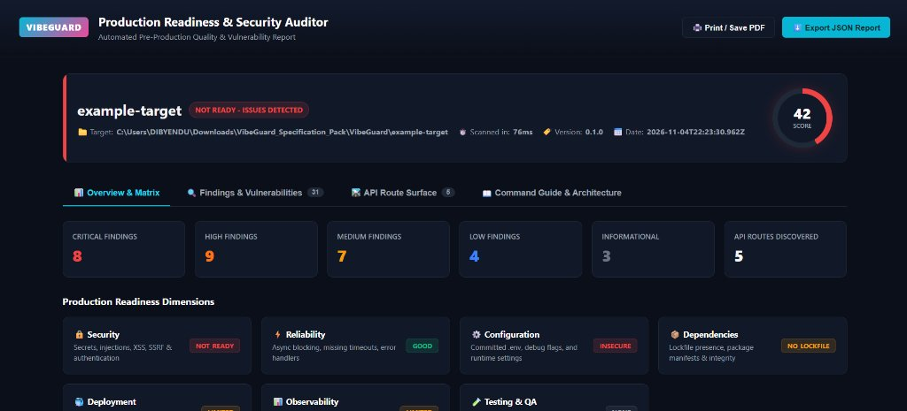
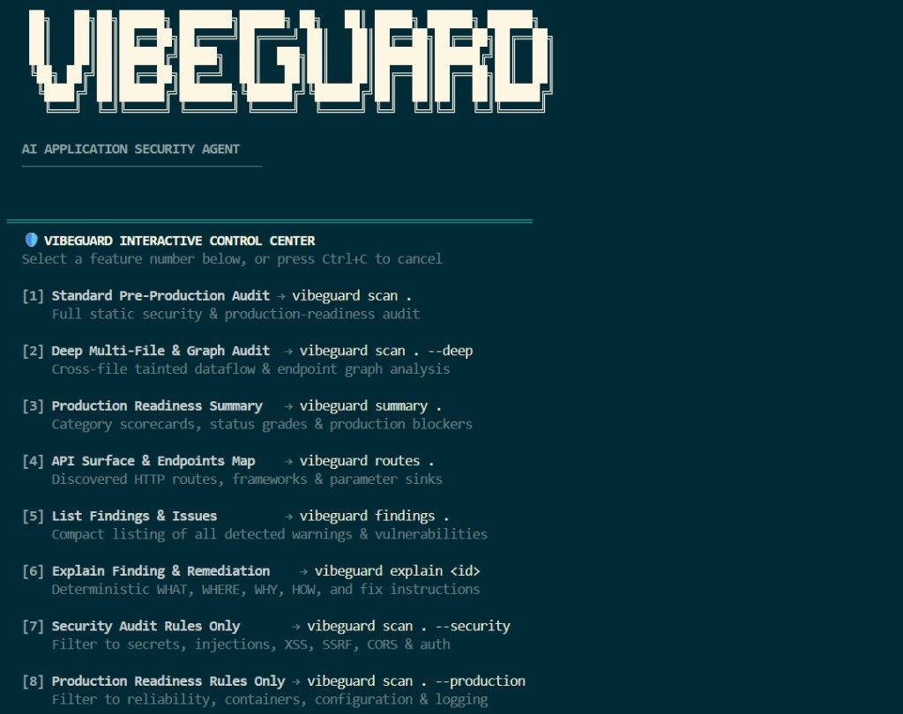

# VibeGuard

> **AI-Native Pre-Production Security, Reliability, and Production Readiness Auditor** for applications built with traditional coding or AI/vibe-coding tools.

<p align="center">
  
</p>

---

## 🌟 Overview

When building applications with AI coding tools (vibe-coding) or rapid traditional development, features are built fast—but production readiness risks often accumulate unnoticed:
- **Async calls without error handling** or **synchronous file I/O blocking request handlers**
- **Docker containers configured to run as root** with floating `:latest` base images
- **Secrets printed in CI/CD workflow logs** or committed `.env` files
- **Missing health/readiness endpoints** and **absent graceful shutdown signal handlers**
- **Unbounded in-memory state containers** and **swallowed exceptions**

**VibeGuard** transforms security auditing into a complete **DEVELOPMENT → SECURITY → RELIABILITY → PRODUCTION READINESS** quality system. It scans your codebase deterministically, builds a multi-file application dependency graph, traces data flows, and tells you:

> **"Is this application actually ready to be shipped to production?"**

---

## 🚀 Key Features

| Dimension | Description | What VibeGuard Audits |
| :--- | :--- | :--- |
| 🔒 **Security** | Vulnerability & Access Audit | Secret leakage, SQL/Command/XSS injection, SSRF, Path Traversal, Auth/Authz weaknesses, Insecure CORS & Headers. |
| ⚡ **Reliability** | Async & Resource Safety | Sync I/O blocking in HTTP paths, missing network timeouts, swallowed exceptions, unhandled promises, unbounded queues. |
| ⚙️ **Configuration** | Environment & Secrets | Debug flags in production, committed `.env` files, insecure cookie flags, undocumented environment variables. |
| 🐳 **Deployment** | Docker & CI/CD Safety | Root user execution, floating `:latest` image tags, copied `.env` layers, missing `HEALTHCHECK`, secrets leaked in CI logs. |
| 📊 **Observability** | Telemetry & Health | `/healthz` endpoints, `SIGTERM`/`SIGINT` graceful shutdown listeners, structured logging vs unstructured console logs. |
| 🧪 **Testing** | QA Ecosystem | Test suite presence (Vitest, Jest, PyTest) and automated test execution steps in CI workflows. |
| 🛡️ **Data Safety** | Credential Exposure | Plaintext credential logging, sensitive GET query parameters, password hash leakage in API responses (with auto secret masking). |

---

## 📦 Installation & Setup

### Prerequisites
- **Node.js**: v18.0.0 or higher
- **npm**: v9.0.0 or higher

### Step 1: Clone the Repository
```bash
git clone <your-repository-url>
cd VibeGuard
```

### Step 2: Install Dependencies & Build
```bash
npm install
npm run build
```

### Step 3: Link CLI Globally (Optional)
To use the `vibeguard` command anywhere in your terminal:
```bash
npm link
```
Verify the installation:
```bash
vibeguard --version
```

---

## 📖 CLI Usage & Command Reference

### 0. Interactive Control Center (`vibeguard` or `vibeguard menu`)
Launches the interactive banner and feature selection control center where you can choose which action to run:
```bash
vibeguard
# or
vibeguard menu
```

<p align="center">
  
</p>

### 1. Interactive Web Dashboard (`vibeguard dashboard`)
Launches a web dashboard view with dark mode, audit matrix scorecards, interactive finding filters, code evidence previews, API surface map, and an interactive **Command Guide** explaining what happens in each audit step:
```bash
# Launch interactive dashboard server and open in browser:
vibeguard dashboard example-target

# Or save static HTML report without starting a server:
vibeguard scan example-target --html
```

<p align="center">
  
</p>

### 2. Perform a Full Audit (`vibeguard scan`)
Audits the current target directory and renders a production readiness summary:
```bash
vibeguard scan .
```
Deep multi-file application graph scan:
```bash
vibeguard scan . --deep
```

### 3. Filter Audit by Dimension (`--category`)
Focus on a specific auditing category (e.g., `reliability`, `deployment`, `configuration`, `security`):
```bash
vibeguard scan . --category reliability
vibeguard scan . --category deployment
```

### 4. Display Production Readiness Summary (`vibeguard summary`)
Renders a high-level Production Readiness matrix table:
```bash
vibeguard summary .
```

### 5. Explain Findings Without AI (`vibeguard explain <id>`)
Get detailed, structured remediation guidance (WHAT, WHERE, WHY, HOW, IMPACT, HOW TO FIX) for any finding ID deterministically:
```bash
vibeguard explain VBG-REL-001 --target .
```

### 6. Inspect Discovered API Surface (`vibeguard routes`)
Lists all discovered HTTP endpoints (Express, Next.js, Flask, FastAPI) with authorization and risk flags:
```bash
vibeguard routes .
```

### 7. List All Findings (`vibeguard findings`)
Displays all active findings sorted by severity:
```bash
vibeguard findings .
```

### 8. Baseline Management (`vibeguard baseline`)
Suppress existing legacy findings for clean incremental auditing:
```bash
# Create baseline from current state
vibeguard baseline create . -o .vibeguard-baseline.json

# Run scan using baseline
vibeguard scan . --baseline .vibeguard-baseline.json
```

### 9. Machine-Readable Export (`--json` / `--sarif`)
Export results for CI/CD pipelines, GitHub Security tab, or IDE integrations:
```bash
vibeguard scan . --json > report.json
vibeguard scan . --sarif > report.sarif
```

---

## 🔕 Suppressions & Inlining

VibeGuard requires explicit Rule IDs for suppressions—wildcard ignore is strictly prohibited.

### 1. Project-wide Suppression File (`.vibeguardignore`)
Create a `.vibeguardignore` file in your repository root and list specific rule IDs or fingerprints:
```text
# Ignore missing health check advisory on legacy service
VBG-OBS-001

# Ignore sync file read in internal build script
VBG-REL-001
```

### 2. Inline Code Suppression Comments
Add inline comments directly above or on the target code line:
```javascript
// vibeguard-ignore-line VBG-SECRET-001
const testApiKey = "sk_test_123456789";

/* vibeguard-ignore-file VBG-CONFIG-001 */
```

---

## 🚦 Exit Codes for CI/CD Pipelines

| Exit Code | Meaning | Action Needed |
| :---: | :--- | :--- |
| **`0`** | **Clean Audit / Passed** | Ready for production deployment. |
| **`1`** | **Warnings Detected** | Findings exist but remain below blocking threshold (`HIGH`). |
| **`2`** | **Policy Threshold Failure** | Critical or High production risks detected. CI build should fail. |
| **`3`** | **Scanner Error** | Target path error or configuration error. |

---

## 🛡️ Guarantees & Security

1. **100% Deterministic & Local:** No external LLM or network API key required.
2. **Zero Target Code Execution:** VibeGuard never executes your application code, test suites, or shell commands from target files.
3. **Zero Dependency Installation:** Never runs `npm install`, `pip install`, or target package lifecycle scripts (`preinstall`, `postinstall`).
4. **Secret Redaction:** Plaintext passwords, tokens, and API keys are automatically masked in stdout and JSON reports.

---

## 🛠️ Tech Stack & Architecture

- **Engine:** Node.js / TypeScript
- **CLI Infrastructure:** Commander.js, Picocolors
- **Testing:** Vitest (66 tests across 19 test suites, 100% pass rate)

---

## 📄 License

MIT License. Built for developers, security auditors, and vibe-coders worldwide.
